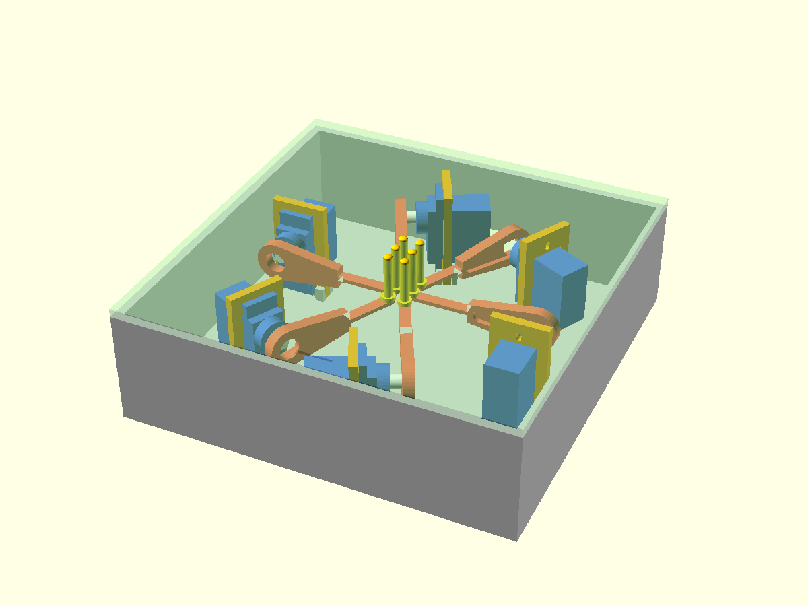
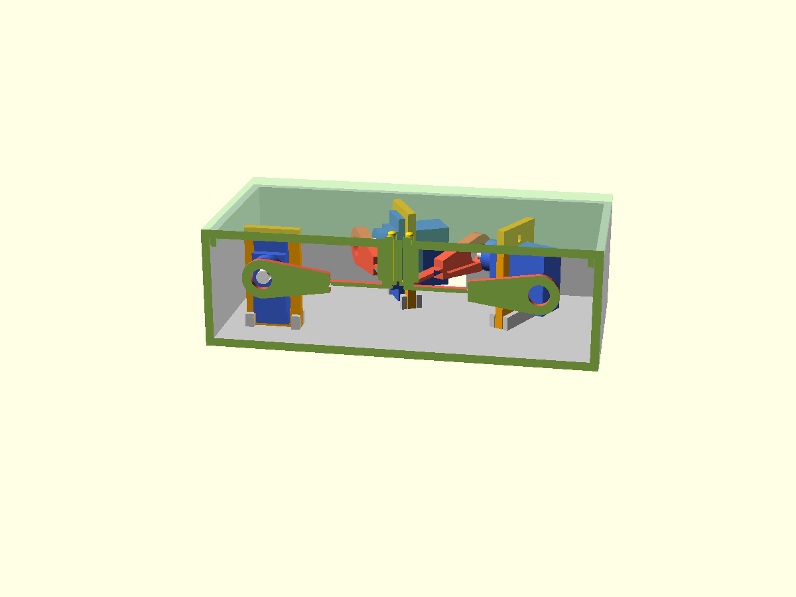
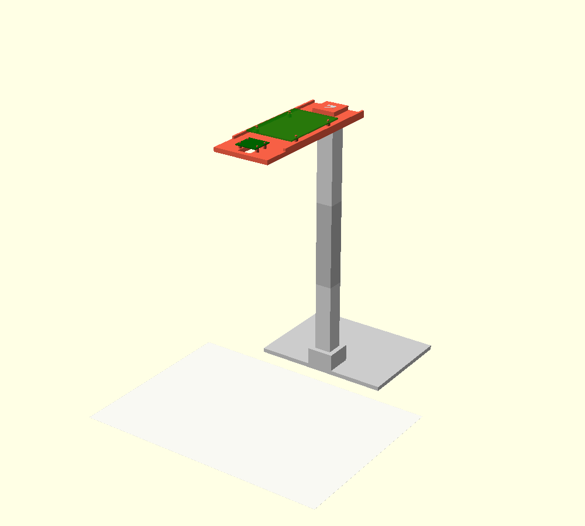

# 기구 설계 — 서보 고정과 카메라 거치

기획안의 "기구물은 별도 제작" 부분을 위한 제작 안내. 수치는 시작점이며, 조립 후 `servo_test`로 맞춘다.

참고: Cornell ECE5725 (2019 Fall) "Braille Translator" 프로젝트는 SG90 6개의 혼 끝에 곧은 철사를 걸어 상자 윗면 구멍으로 밀어 올렸고, 서보는 0~45°만 움직였다. 이 문서의 1단계는 그 방식을 그대로 따르고, 2단계는 그 팀이 남긴 과제(기구가 크고 흔들림)를 보완한다.

## 0. 3D 프린트 버전 (추천, 최소 준비물)

모델: [hardware/braille_cell.scad](../hardware/braille_cell.scad), [hardware/camera_stand.scad](../hardware/camera_stand.scad). 출력용 STL은 `hardware/stl/`.
치수를 바꾸려면 `.scad` 맨 위 값을 고치고 `bash hardware/export_stl.sh`로 STL을 다시 만든다 (OpenSCAD 필요).

### 구조

| 조립 미리보기 | 단면 (뚜껑 반투명) | 카메라 스탠드 |
|---|---|---|
|  |  |  |


- 서보 6개를 셀 주위에 원형으로 세우고, 각 서보의 **레버가 자기 점 방향에서 들어와 핀 아래 턱(플랜지)을 직접 밀어 올린다.** 연결 철사가 없다.
- 플랜지가 뚜껑 아래 돌기부에 닿는 높이 = 돌기 높이(1mm). 서보 각도가 조금 넘쳐도 높이는 같다.
- 레버 끝이 얇아(2mm) 살짝 휜다. 서보가 조금 더 돌아도 무리가 없고, 그 탄성으로 돌기를 받친다.
- 서보는 받침판에 나사로 고정한 뒤 바닥의 홈에 세워 끼우고, 뚜껑이 위에서 눌러 고정한다.
- 셀: 점 간격 6mm, 핀 지름 3mm (확대 셀). 상자 118 × 118 × 41mm.

### 출력 목록

| STL | 개수 | 방향·설정 |
|---|---:|---|
| `cell_fit_test` | 1 | **가장 먼저.** 구멍 여유 0.2/0.3/0.4/0.5mm (홈 1~4개로 표시) 중 핀이 가장 부드럽게 움직이는 값을 `pin_clear`에 넣고 STL을 다시 만든다 |
| `cell_base` | 1 | 그대로 (바닥이 아래) |
| `cell_servo_mount` | 6 | 그대로 (눕힌 판) |
| `cell_lever_a` | 4 | 점 1·3·4·6용. 그대로 (혼 홈이 위) |
| `cell_lever_b` | 2 | 점 2·5용 (조금 더 김) |
| `cell_pin` | 6 + 여분 2 | 세워서, 레이어 0.12~0.16mm |
| `cell_lid` | 1 | 그대로 (손가락 닿는 면이 아래) |
| `stand_base` | 1 | 그대로 |
| `stand_column` | 3 | 세워서 (돌기가 위) |
| `stand_arm` | 1 | 그대로 |

서포트 없이 출력되도록 방향을 잡아 두었다. PLA, 인필 20% 이상, 레버는 인필 100%(휘는 부분이 얇다).

### 출력 순서와 예상 시간

예상 시간은 일반 프린터(Ender-3급, 0.2mm 레이어, 약 50mm/s) 기준 대략값이다. 고속 프린터는 절반 이하로 줄어든다. 정확한 시간은 슬라이서가 보여 준다.
필라멘트는 STL 부피로 계산하면 PLA 약 210g (셀 약 90g, 스탠드 약 120g)이다.

| 단계 | 출력할 것 | 예상 시간 | 끝나면 확인할 것 |
|---|---|---|---|
| **1. 맞춤 시험** | `cell_fit_test` ×1, `cell_servo_mount` ×1, `cell_lever_a` ×1 | 약 1~1.5시간 | 핀이 가장 부드러운 구멍 → `pin_clear`. 서보가 받침판 구멍에 들어가고 탭 나사 구멍이 맞는지, 혼이 레버 홈에 맞는지 → 안 맞으면 `[SG90 치수]` 고치고 `export_stl.sh` |
| **2. 작은 부품** | `cell_servo_mount` ×5, `cell_lever_a` ×3, `cell_lever_b` ×2, `cell_pin` ×8 (0.12~0.16mm 레이어, 따로 출력) | 약 2~2.5시간 | 레버 끝이 손으로 눌러 살짝 휘는지 |
| **3. 큰 부품** | `cell_lid` ×1 (약 2~2.5시간), `cell_base` ×1 (약 3.5~4.5시간) | 약 6~7시간 (밤새 출력 추천) | 뚜껑이 상자에 맞는지, 핀이 뚜껑 구멍에서 걸림 없이 움직이는지 |
| → 조립 | 셀 조립 후 `servo_test`로 각도 보정 | | 카메라 없이도 점자 출력까지 시험 가능 |
| **4. 카메라 스탠드** | `stand_arm` ×1 (약 2시간) → `stand_base` ×1 (약 3시간) → `stand_column` ×3 (한 번에, 약 3.5~4시간) | 약 8~9시간 | 팔: 파이·카메라 핀이 구멍에 맞는지 먼저 확인 (안 맞으면 `cam_peg_d`·`pi_peg_d` 조정) |

- 합계: 셀 약 9~11시간 + 스탠드 약 8~9시간.
- 1단계를 먼저 하는 이유: 핀 구멍 여유와 SG90 치수가 틀리면 뚜껑·상자·받침판을 다시 출력해야 한다. 작은 시험 부품으로 먼저 맞춘다.
- 뚜껑과 핀은 `pin_clear`를 정한 **뒤에** 출력한다.
- 스탠드는 카메라가 있어야 필요하므로 마지막에 출력해도 된다.

### 준비물 (3D 프린트 외)

- SG90 상자에 들어 있는 나사 (받침판 고정 2개씩, 혼 고정 1개씩)와 외팔 혼
- 마스킹테이프 (조립할 때 핀을 잡아 두는 용도)
- (헐거울 때만) 순간접착제

### 조립 순서

1. `fit_test`로 `pin_clear`를 정하고, 핀·뚜껑을 그 값으로 다시 출력한다.
2. 서보를 하나씩 PCA9685에 연결하고 `python -m braille_reader.servo_test --angle <점> 90` 으로 90°에 맞춘다.
3. 외팔 혼을 **수평**(셀 쪽을 향하게)에 가장 가깝게 끼우고 나사로 고정한다.
4. 레버 뒷면 홈에 혼 팔이 들어가게 끼운다. 헐거우면 순간접착제 한 방울.
5. 서보를 받침판 구멍에 넣고 탭을 나사로 고정한 뒤, 받침판을 바닥 홈에 세워 끼운다. 레버가 셀 중심을 향해야 한다 (점 번호는 뚜껑 앞쪽 표시 기준: 사용자 쪽 = 앞, 점 1 = 왼쪽 위).
6. 뚜껑을 뒤집어 핀 6개를 플랜지가 위로 오게 꽂고, 손가락 닿는 면 쪽 핀 끝을 마스킹테이프로 붙여 둔다.
7. 뚜껑을 덮고 테이프를 뗀다. 핀이 레버 끝에 얹힌다. 전선은 뒤쪽 구멍으로 뺀다.
8. 점마다 `servo_test --angle`로 올림(핀이 멈출 때까지 + 3~5°)과 내림(올림에서 8~10° 반대로) 각도를 찾아 `config.py`에 적는다.

### 치수를 꼭 재야 하는 값 (서보 제조사마다 다름)

`braille_cell.scad`의 `[SG90 치수]` 항목. 특히 `horn_face`(몸체 윗면 ~ 혼 바깥면), `tab_top`(몸체 바닥 ~ 탭 윗면), 외팔 혼 크기(`horn_*`). 자가 없으면 기본값으로 먼저 출력해 맞춰 보고, 어긋난 만큼 고친다.

### 카메라 스탠드

- 받침은 기둥 **뒤쪽**으로 뻗고, 기둥 앞 바닥이 문서 자리다. 받침 위에 책을 올려 두면 더 안정적이다.
- 카메라는 팔 끝에 **엎어서**(렌즈가 아래 구멍으로) 핀에 끼우고, 라즈베리파이는 팔 위 카메라 가까이에 끼운다. 기본 카메라 케이블로 닿는다.
- 렌즈 높이 약 30cm (`seg_count`, `seg_len`으로 조절).

## 1. 셀 크기 정하기

| 선택 | 점 간격 | 핀 지름 | 돌기 높이 | 비고 |
|---|---|---|---|---|
| **확대 셀 (MVP 추천)** | 5~6mm | 2~3mm | 약 1mm | 만들기 쉽고 손끝 구분이 쉽다 |
| 표준 셀 | 약 2.5mm | 약 1.5mm | 약 0.5mm | 정밀 가공 필요. 제작 전 정확한 규격을 따로 확인 |

셀 크기는 기구만 바뀌고 코드는 그대로다. 확대 셀로 동작을 확인한 뒤 줄인다.

## 2. 1단계 — 철사 연결 시제품 (Cornell 방식)

```
   손가락 ↓
 ┌───────○─○───────┐   ← 상자 윗판: 구멍 6개 (철사 지름 + 0.2mm)
 │       │ │       │
 │      ╱   ╲      │   ← 곧은 철사 (19게이지 ≈ 0.9mm, 또는 피아노선 0.8mm)
 │  [서보]   [서보]  │      혼 끝 구멍에 Z자로 구부려 걸기, 연결부는 헐겁게
 └─────────────────┘   ← 바닥판: 서보 6개 고정
```

- 서보 배치: 왼쪽 열(점 1·2·3) 서보 3개는 왼쪽, 오른쪽 열(점 4·5·6) 3개는 오른쪽에 두 줄로. 혼이 셀 쪽을 향하게 한다.
- 서보 고정: SG90에 들어 있는 M2 나사로 바닥판에. 시제품은 양면 폼테이프·글루건도 가능.
- 철사 끝(손가락에 닿는 쪽)은 줄로 갈아 둥글게 하거나 수축튜브를 씌운다.
- 혼이 돌 때 철사가 위아래로만 움직이도록, 윗판 구멍은 철사보다 조금만 크게.
- 이 단계 목표: 6개 점이 각각 오르내리는지, 손끝으로 패턴이 구분되는지 확인.

## 3. 2단계 — 가이드 판 + 멈춤 턱

1단계에서 철사 끝이 흔들리거나 돌기 높이가 들쭉날쭉하면 추가한다.

```
 ┌───────○─○───────┐   ← 윗판
 │       ┃ ┃       │   ← 핀 (막대). 아래쪽에 멈춤 턱(칼라·수축튜브)
 ├───────┸─┸───────┤   ← 아랫판: 같은 위치에 구멍. 윗판과 5~10mm 간격
 │      ╱   ╲      │   ← 철사가 핀 아래쪽을 밀고 당긴다
 │  [서보]   [서보]  │
 └─────────────────┘
```

- 판 두 장이 핀을 수직으로 잡아 준다 (구멍 한 개로는 기울어짐).
- 멈춤 턱이 윗판에 닿는 위치 = 최대 돌기 높이. 서보 각도가 조금 넘쳐도 높이가 일정하다.
- 철사가 핀을 밀어 올리고 **당겨 내리기도** 하게 연결한다 (중력에만 맡기면 덜 내려간다).
- 재료: 3D 프린트(PLA) 또는 3mm 아크릴 레이저 커팅.

## 4. 서보 각도 맞추기

1. 조립 전, 서보 혼을 90°에 맞춰 끼운다: `python -m braille_reader.servo_test --angle 1 90`
2. 조립 후 점마다 내림/올림 각도를 찾는다: `servo_test --angle <점> <각도>`
   - 혼 반지름 약 10mm 기준으로 1mm 높이는 수 도 ~ 10° 정도. Cornell 팀은 0~45° 범위를 썼다.
3. 찾은 값을 `config.py`의 `SERVO_DOWN_ANGLE`, `SERVO_UP_ANGLE`에 적는다.
4. `servo_test --text 가나다`로 확인.
5. 멈춤 턱에 닿은 채로 서보가 계속 밀면 웅웅거리고 뜨거워진다. 올림 각도를 턱 바로 앞으로 줄이거나 `SERVO_RELEASE_AFTER_MOVE`를 시험한다.

## 5. 카메라 거치대

- Cornell 팀처럼 문서 위 약 30cm에 카메라를 아래로 향하게 고정한다 (나무·알루미늄 프레임, 스탠드 등).
- Camera Module 3 (표준 화각)는 30cm 높이에서 대략 A4 폭보다 넓게 찍힌다. 25~35cm에서 시작해 `rpicam-hello`로 보며 조정.
- 문서 놓는 자리를 바닥에 표시(모서리 턱)해 두면 매번 같은 위치에 찍힌다.
- 위치가 고정되면 `captures/last.jpg`를 보고 문서 부분만 남도록 `config.py`의 `OCR_CROP`을 정한다 (Cornell 팀도 고정 영역을 잘라 OCR했다).
- 조명: 그림자가 지지 않게 위쪽 양옆에서. 고르지 않은 조명은 `OCR_THRESHOLD_METHOD = "adaptive"`(기본값)가 어느 정도 보정한다.

## 6. 전원 (다시 한번)

서보 6개는 반드시 5V 5A 어댑터 → PCA9685 `V+`로. 라즈베리파이 5V 핀에서 끌어오지 않는다. 자세한 배선은 [배선도.md](배선도.md).
